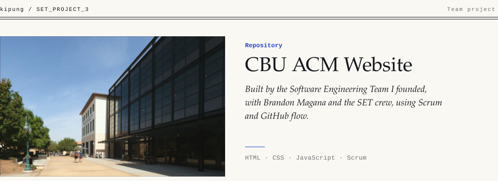

<picture><source media="(prefers-color-scheme: dark)" srcset=".github/banner-dark.svg"></picture>

The website for the **ACM chapter at California Baptist University**, built by the chapter's **Software Engineering Team (SET)**. It was run like a real team project, with branches, pull requests and sprints, using Scrum and GitHub flow.

## Pages

| Page | File |
| --- | --- |
| Home | `html/index.html` |
| About | `html/about.html` |
| Teams | `html/teams.html`, `html/teams_dev.html` |
| Contact | `html/contact.html` |

The site is plain HTML, CSS (`css/`) and a little JavaScript (`js/teams.js`). Open `html/index.html` in a browser, or serve the folder:

```bash
python3 -m http.server 8000   # then open http://localhost:8000/html/
```

## Team

Built by the ACM SET:
[Ki-Pung (Kip) Park](https://github.com/kipung) (founder and lead),
[Brandon Magana](https://github.com/ghbrando),
[Joshua Parsio](https://github.com/jmparsio),
[Ethan Walden](https://github.com/EthanScottWalden),
[Christian Gonzalez](https://github.com/christiannngg),
[@Mrhaneul](https://github.com/Mrhaneul) and
[@JoshuaAB5](https://github.com/JoshuaAB5).

## Contributing

1. Check out `devBranch` and pull the latest: `git checkout devBranch && git pull`.
2. Branch from it with the `feature/<what-you-are-building>` naming convention, for example `git checkout -b feature/teams-page`.
3. Open a pull request back into `devBranch`.
